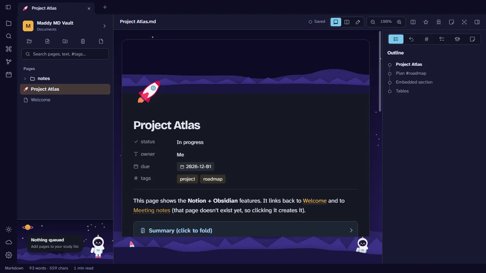

# Maddy MD

A reading room for your Markdown. Maddy MD is a free Windows app that opens any folder of `.md` and `.txt` files and makes them pleasant to read, study and write. Your files stay plain; everything personal stays out of them.

**Website:** <https://maddy-md.vercel.app> · **Download:** [latest release](https://github.com/ahm-raz/maddy-md/releases/latest)



## Features

- **Read, split or write** on one page, with autosave.
- **Paste from ChatGPT or Claude** and get clean Markdown. `Ctrl+Shift+V` makes a new page from the clipboard.
- **GitHub-flavoured Markdown**, callouts, toggles, task lists, tables, sanitized HTML, YAML properties with page icons and covers.
- **Mermaid diagrams** with a canvas you can pan, zoom and export as SVG or PNG.
- **Wikilinks, backlinks, tags, outline and a graph view.**
- **Tabs, split panes, a quick switcher and a command palette.**
- **Study list, to-dos and sticky notes**, stored on your PC and never written into your files.
- **15 cut-paper themes** with original characters, plus fonts, widths and motion controls.
- **Optional sync** to a private GitHub Gist with your own token.

## Install

Download one of these from [Releases](https://github.com/ahm-raz/maddy-md/releases/latest):

| File | What it is |
|---|---|
| `Maddy-MD-Setup-1.0.0.exe` | Installer. Adds shortcuts and opens `.md` files on double-click. |
| `Maddy-MD-Portable-1.0.0.exe` | Runs without installing. |

Windows 10 or 11, 64-bit. The app is not code-signed yet, so Windows SmartScreen may show "Windows protected your PC": choose **More info**, then **Run anyway**.

The full guide (first run, sync, shortcuts, where data is kept) is in [docs/SETUP-GUIDE.md](docs/SETUP-GUIDE.md).

## Repository layout

| Folder | What it is |
|---|---|
| `app/` | The desktop app: Electron, vanilla HTML/CSS/JS. See `app/DESIGN.md` and `app/PRODUCT.md`. |
| `web/` | The website at maddy-md.vercel.app: React, TypeScript and Vite. |
| `docs/` | The setup guide. |

### Run or build the app

```
cd app
npm install
npm start          # run from source
npm run dist       # build the installer and portable .exe into app/dist
```

If `npm run dist` fails with "Cannot create symbolic link", turn on Windows Developer Mode or run the terminal as administrator once.

### Run the website

```
cd web
npm install
npm run dev
```

The site deploys to Vercel from the repository root; `vercel.json` points the build at `web/`.

## Formerly MarkLens

Maddy MD was developed under the name MarkLens. On first launch, it copies settings from `%APPDATA%\MarkLens` if they exist, and sync still finds gists named `MarkLens Sync: <folder>`.
