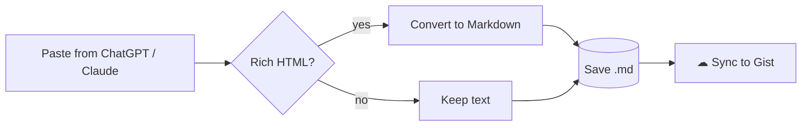
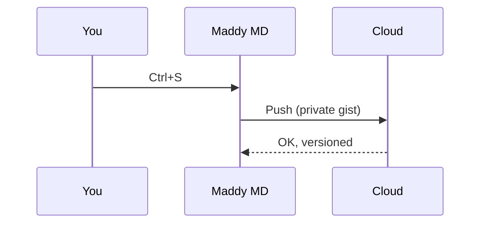

# Welcome to Maddy MD ◆

Maddy MD renders **Markdown**, *Mermaid* diagrams, `inline code`, tables, toggles and raw <mark>HTML</mark>, beautifully.

> [!TIP]
> Press <kbd>Ctrl</kbd>+<kbd>,</kbd> to open **Customize**: 15 themes, fonts, width, spacing and more.

> [!WARNING]
> Click any diagram below to open it in the **canvas**, where you can pan, zoom and export it as SVG or PNG.

## Mermaid flow





## Tables

| Feature | Status | Notes |
|:--|:--:|--:|
| Markdown + GFM | ✅ | tables, tasks, strikethrough |
| Mermaid canvas | ✅ | pan / zoom / export |
| Cloud sync | ✅ | GitHub Gist (free) |
| HTML render | ✅ | sanitized |

## Tasks (click them!)

- [x] Open a folder
- [ ] Paste something from Claude
- [ ] Try the **Deep Reef** theme

## Toggle

<details>
<summary>Click to expand a hidden section</summary>

Toggles support **full markdown** inside, including code:

```python
def hello(name):
    return f"Hello, {name}!"
```
</details>

## Code

```ts
type Doc = { path: string; text: string };
export const words = (d: Doc) => d.text.split(/\s+/).length;
```

---

<div style="padding:16px;border-radius:12px;background:linear-gradient(135deg,#7c5cff,#22d3ee);color:white">
  <b>Raw HTML works too.</b> Toggle it in Customize → Content.
</div>
